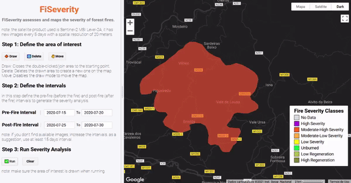
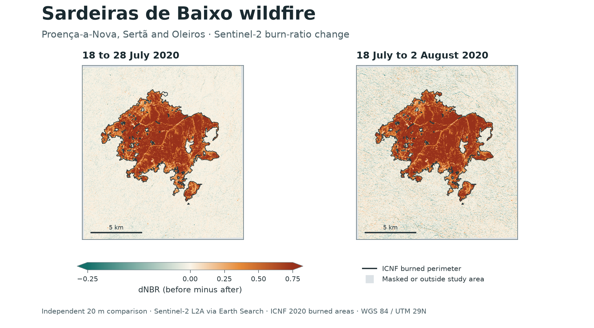

# FiSeverity

FiSeverity maps wildfire burn severity from Sentinel-2 imagery in Google Earth Engine. Draw an area, enter two date ranges, and inspect the classified map, imagery layers, and area-by-class chart.

## Get started in Google Earth Engine

1. Open the [Earth Engine Code Editor](https://code.earthengine.google.com/) and sign in with a Google account that has access to a registered Google Cloud project with the Earth Engine API enabled. Select that project when prompted. [Earth Engine access setup](https://developers.google.com/earth-engine/guides/access)
2. Open [API-EN.js](API-EN.js) for English or [API-PT.js](API-PT.js) for Portuguese. Use **Copy raw file** on GitHub to copy the JavaScript. In the Code Editor's **Scripts** tab, create a new file in a repository under **Owner**. Paste one complete script into the center pane and click **Save**. A name such as `FiSeverity` will make it easy to find. [Code Editor guide](https://developers.google.com/earth-engine/guides/playground)
3. Click **Run** on the Code Editor toolbar to open the FiSeverity panel and map. After filling in the case below, click **Run** inside the FiSeverity panel to start the analysis. The Portuguese button is **Executar**.
4. To export results, use the Code Editor's **Tasks** tab and start `Export_dNBR` for the GeoTIFF or `Export_AOI` for the KML. Both export to Google Drive.

**If the dark basemap module cannot be loaded**, request read access to `users/yurigaufrrj/packages:darkMap.js` or use a built-in basemap. To use the built-in basemap, delete the line beginning `var baseMap = require(` and replace **both** `mapPanel.setOptions("Dark", { Dark: baseMap.darkTheme });` calls with `mapPanel.setOptions("HYBRID");`. Save your copy and click the toolbar **Run** again. [Map basemap options](https://developers.google.com/earth-engine/apidocs/ui-map-setoptions)

## First use case — Proença-a-Nova, Portugal

The Sardeiras de Baixo wildfire started in Oleiros on 25 July 2020, spread to Sertã and Proença-a-Nova, and was extinguished on 29 July. Portugal's conservation and forestry institute (ICNF) reported **5,592 ha** burned across the three municipalities, including **466 ha** in Proença-a-Nova. Use these figures and the Copernicus delineation as references when interpreting the output. [ICNF report, sections 2 and 2.10](https://fogos.icnf.pt/download/REE/2020_002/REE_2020_002.pdf) · [Copernicus emergency mapping](https://mapping.emergency.copernicus.eu/activations/EMSR448/)

1. **Locate the area.** Zoom to the area north of Proença-a-Nova. To center the app there directly, replace the `mapPanel.setCenter(...)` line in your copy with `mapPanel.setCenter(-7.94, 39.825, 12);` and click the Code Editor toolbar **Run**.
2. **Draw the area of interest.** Select **Draw** (**Desenhar**), trace the rectangle, and double-click to finish. The southwest corner is **39.750° N, 8.030° W**, and the northeast corner is **39.900° N, 7.850° W**. The [GeoJSON](examples/proenca-a-nova-aoi.geojson) provides all four corners in longitude–latitude order. The rectangle covers the reported perimeter and surrounding land for comparison.
3. **Enter four dates** in `YYYY-MM-DD` format. Use the original demo for your first run. Draw the area again before running the second scenario if the first run cleared it.

   | Scenario | Pre-Fire start | Pre-Fire end | Post-Fire start | Post-Fire end |
   |---|---|---|---|---|
   | Reproduce the archived GIF | `2020-07-15` | `2020-07-20` | `2020-07-25` | `2020-07-30` |
   | Compare a scene acquired after extinguishment | `2020-07-15` | `2020-07-20` | `2020-07-30` | `2020-08-09` |

4. **Run and compare.** Click **Run** inside FiSeverity. In the map's layer list, inspect the Sentinel-2 imagery and the classified dNBR layer. Use the legend and chart to interpret the result, then compare the scar's location and shape with the Copernicus map.

The GIF's second date range begins on the ignition date and includes the Sentinel-2 acquisition of 28 July. The second scenario allows the acquisition of 2 August, after extinguishment. Earth Engine excludes the end date of each range. If either range contains no usable scenes, extend that range while keeping the first window before ignition and the second aligned with the scenario. [Earth Engine date filtering](https://developers.google.com/earth-engine/apidocs/ee-imagecollection-filterdate)

### Independent Sentinel-2 check

A separate 20 m calculation used Sentinel-2 bands B8 and B12 from tile `29TNE`, scene classification masking, and the ICNF perimeter for ANEPC occurrence `2020050017687`. Using 18 July as the baseline, median dNBR inside the perimeter was **0.677 on 28 July** and **0.719 on 2 August**, compared with **0.002 outside** on both dates. The figure shows continuous dNBR from that separate calculation. [Earth Search Sentinel-2 data](https://github.com/Element84/earth-search/blob/main/docs/collections/sentinel-2-l2a.md) · [ICNF 2020 burned-area layer](https://sigservices.icnf.pt/server/rest/services/BDG/areas_ardidas/MapServer/0)

## How the analysis works

The current scripts use `COPERNICUS/S2_SR_HARMONIZED` and the Sentinel-2 Scene Classification Layer (`SCL`) to mask defective pixels, cloud shadows, clouds, and cirrus. They mosaic the usable images for each window and compute NBR from the near-infrared (`B8`) and shortwave-infrared (`B12`) bands. Pre-fire NBR minus post-fire NBR gives dNBR. FiSeverity scales it by 1,000 for classification. Results depend on date selection, imagery coverage, cloud masking, and class thresholds. [Sentinel-2 catalog](https://developers.google.com/earth-engine/datasets/catalog/COPERNICUS_S2_SR_HARMONIZED) · [Changelog](CHANGELOG.md)

## Presentations

| Event | Materials |
|---|---|
| Comitê Piabanha, 2020 | [Presentation (PDF)](presentations/2020-piabanha.pdf) · [Event announcement](https://comitepiabanha.org.br/artigo/comita-piabanha-promove-a-quinta-palestra-prevista-em-seu-plano-de-comunicaaao/NDI1NQ%3D%3D) |
| SIGABI, 2021 | [Presentation (PDF)](presentations/2021-sigabi.pdf) · [Interface screenshot](assets/fiseverity-ui.png) · [Official program](https://www.even3.com.br/e/10sigabi-92668) |

## Credits

Yuri Tomaz Martins developed FiSeverity. The code credits Tianjia Liu for the dark basemap styling and UN-SPIDER for reference material used in the legend and legacy cloud masking.
